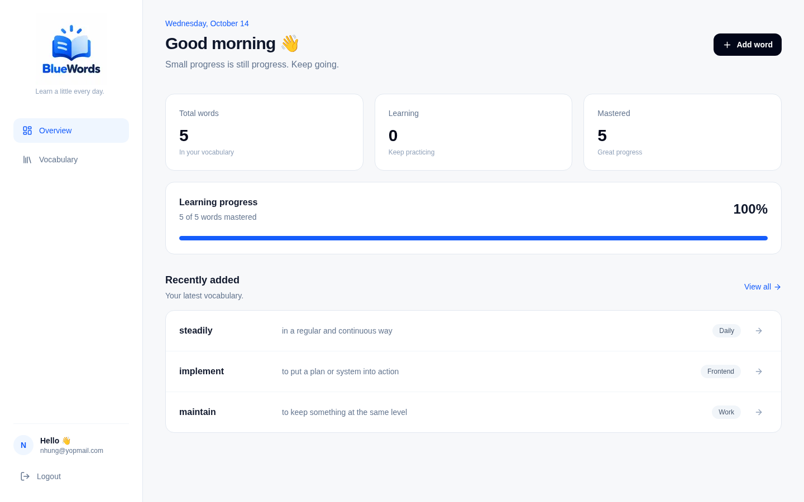
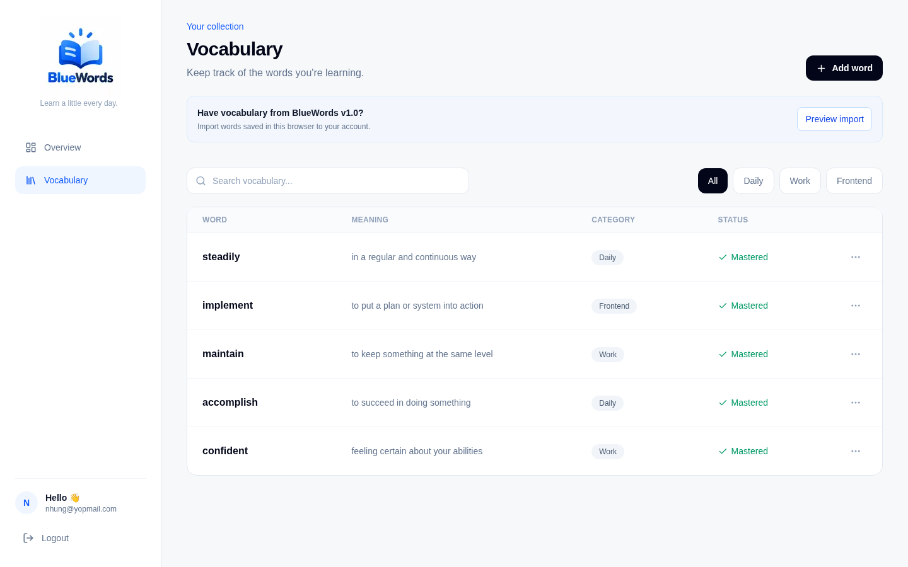

# BlueWords 💙

**A modern vocabulary tracker to help you learn, organize, and master English words.**

BlueWords is a responsive, full-stack vocabulary management application built with **Next.js 16, TypeScript, Tailwind CSS v4, and Supabase**.

It helps users build their personal vocabulary collection, organize words by category, and track learning progress. With Supabase Authentication and PostgreSQL, vocabulary is securely stored in the cloud and associated with each user's account.

### 🔗 Live Demo

**[Try BlueWords](https://bluewords.online/)**

### 📸 Screenshots

#### Dashboard



#### Vocabulary Management



### ✨ Features

**Authentication & Cloud Storage**
- **Optional Authentication** — Guests can explore the starter library and play; sign-in enables personal data and social features.
- **Personal Vocabulary** — Each user manages their own vocabulary collection.
- **Cloud Persistence** — Vocabulary is stored in Supabase PostgreSQL and remains available across sessions and devices.
- **Row Level Security** — Database policies restrict access to each user's own records.
- **Legacy Data Import** — Preview and import vocabulary previously saved in browser localStorage, with duplicate detection.

**Vocabulary Management**
- **CRUD Operations** — Add, edit, and delete vocabulary words.
- **Learning Status** — Mark words as Learning or Mastered.
- **Smart Search** — Find words by English vocabulary or meaning.
- **Custom Categories** — Create, rename, recolor, and delete personal vocabulary categories.
- **Category Filtering** — Filter vocabulary using your own category list.
- **Duplicate Prevention** — Prevent duplicate vocabulary entries within the same account.
- **CSV Import & Export** — Preview and validate CSV files, combine multiple meanings for a word, and export a UTF-8 backup.
- **Community Vocabulary** — Signed-in users can request publication; admins review custom categories and words before they are shared.
- **Admin Tools & Notifications** — Admins manage users and published vocabulary; request and review decisions create notifications.

**Dashboard & User Experience**
- **Dashboard Overview** — Track total words, mastered words, and learning progress.
- **Recent Words** — Quickly review recently added vocabulary.
- **Account Identification** — Display the signed-in user's email in the sidebar.
- **Responsive Design** — Optimized for desktop, tablet, and mobile.
- **Interactive Feedback** — Confirmation dialogs, loading states, and toast notifications.
- **PWA Support** — Includes a web app manifest and app icons for an installable experience.

### Local Node.js version

BlueWords uses Node.js 22, configured in `.nvmrc`. In the project terminal:

```bash
nvm install
nvm use
npm run dev
```

Run `nvm use` when opening a new terminal for this project. This selects Node only for the current terminal; keep your existing nvm default for other projects. To restore the default in the same terminal, run `nvm use default`.

### 🛠️ Tech Stack

| Technology | Purpose |
|---|---|
| Next.js 16 (App Router) | Full-stack React framework and routing |
| React | User interface |
| TypeScript | Type safety |
| Tailwind CSS v4 | Styling and responsive design |
| Supabase Auth | User authentication and session management |
| Supabase PostgreSQL | Cloud database |
| PostgreSQL Row Level Security | User-level data access control |
| React Context API | Shared vocabulary state |
| Supabase SSR | Server-side authentication integration |
| Radix UI Dialog | Accessible dialogs |
| Lucide React | Icons |
| Sonner | Toast notifications |
| Vercel | Hosting and deployment |

### 🏗️ Architecture

BlueWords uses the **Next.js App Router** with Supabase for authentication and data persistence.

- **Authentication:** Supabase Auth manages user accounts and sessions.
- **Protected Pages:** Server-side authentication checks restrict access to the Dashboard and Vocabulary pages.
- **Database:** PostgreSQL stores vocabulary records associated with a user ID.
- **Authorization:** Row Level Security ensures authenticated users can access only their own vocabulary.
- **State Management:** React Context provides shared vocabulary data and CRUD actions to the Dashboard and Vocabulary interface.
- **Data Migration:** An optional import workflow transfers valid legacy vocabulary from browser localStorage into Supabase.

### 🚀 Getting Started

#### 1. Clone the repository

```bash
git clone https://github.com/itcoding2520/bluewords.git
cd bluewords
```

#### 2. Install dependencies

```bash
npm install
```

#### 3. Configure Supabase

Create a Supabase project and configure the vocabulary database schema, authentication, and Row Level Security policies. Existing migrations should already be applied in filename order. For the Phase 3 migrations dated `20261025`, add the Supabase **Session pooler** connection string (port `5432`) to `.env.local` as `DATABASE_URL`, then run `npm run db:migrate:phase3`. The script checks that it targets the same project as `NEXT_PUBLIC_SUPABASE_URL`, applies pending migrations, and records them in a private migration ledger so rerunning it is safe. Do not use the Transaction pooler (port `6543`).

Create a `.env.local` file in the project root:

```env
NEXT_PUBLIC_SUPABASE_URL=your_supabase_project_url
NEXT_PUBLIC_SUPABASE_PUBLISHABLE_KEY=your_supabase_publishable_key
SUPABASE_SERVICE_ROLE_KEY=your_supabase_service_role_key
DATABASE_URL=your_supabase_session_pooler_connection_string
```

Get `DATABASE_URL` from Supabase Dashboard → **Connect** → **Session pooler**. Keep the password private; do not paste it into chat or commit `.env.local`.

The service-role key is only used by the server-side admin user API. After migrations are applied and an account exists, bootstrap the first admin once in the Supabase SQL editor:

```sql
INSERT INTO public.app_admins (user_id)
SELECT id FROM auth.users WHERE email = 'admin@example.com'
ON CONFLICT DO NOTHING;
```

**Security:** Keep `SUPABASE_SERVICE_ROLE_KEY` server-only. Never expose it through a `NEXT_PUBLIC_` variable, and do not commit `.env.local` to Git.

#### 4. Start the development server

```bash
npm run dev
```

#### 5. Open the application

Visit [http://localhost:3000](http://localhost:3000) in your browser.

Create an account or log in to start managing your vocabulary.

### 📁 Project Structure

```text
src/
├── app/
│   ├── login/
│   ├── auth/
│   ├── vocabulary/
│   ├── page.tsx
│   └── layout.tsx
├── components/
│   ├── dashboard/
│   ├── layout/
│   ├── ui/
│   └── vocabulary/
├── config/
├── contexts/
│   └── VocabularyContext.tsx
├── data/
├── hooks/
├── lib/
│   ├── supabase/
│   ├── storage.ts
│   ├── vocabulary-import.ts
│   └── vocabulary-migration.ts
├── types/
│   └── database.ts
└── proxy.ts
```

### 💾 Data Persistence & Security

BlueWords uses **Supabase PostgreSQL** as its primary data store.

- Vocabulary records belong to individual authenticated users.
- PostgreSQL Row Level Security restricts access by user ID.
- Changes are persisted in the cloud rather than browser localStorage.
- Vocabulary can be accessed after signing in on another device or browser.
- Previously saved localStorage vocabulary can be imported manually.
- The import workflow previews available words, skips duplicates, and preserves the original browser data.

### 🧭 Future Improvements

- [ ] Flashcards and vocabulary practice mode
- [ ] Vocabulary quizzes
- [ ] Spaced repetition system
- [ ] Offline vocabulary access

### 🌐 Deployment

BlueWords is deployed on **Vercel**.

**Live application:** [https://bluewords.online](https://bluewords.online)

Production environment variables are configured in Vercel, while authentication and vocabulary storage
