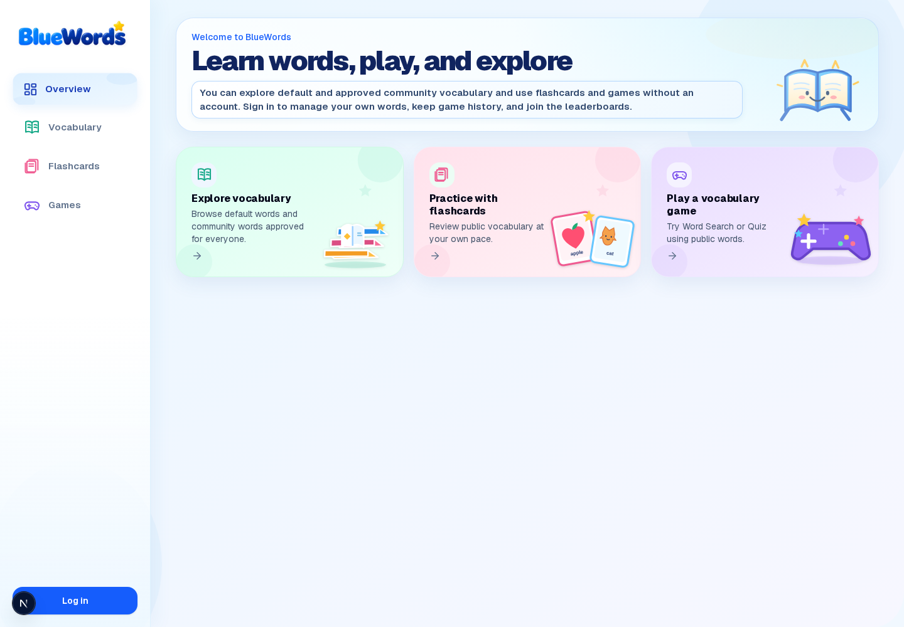
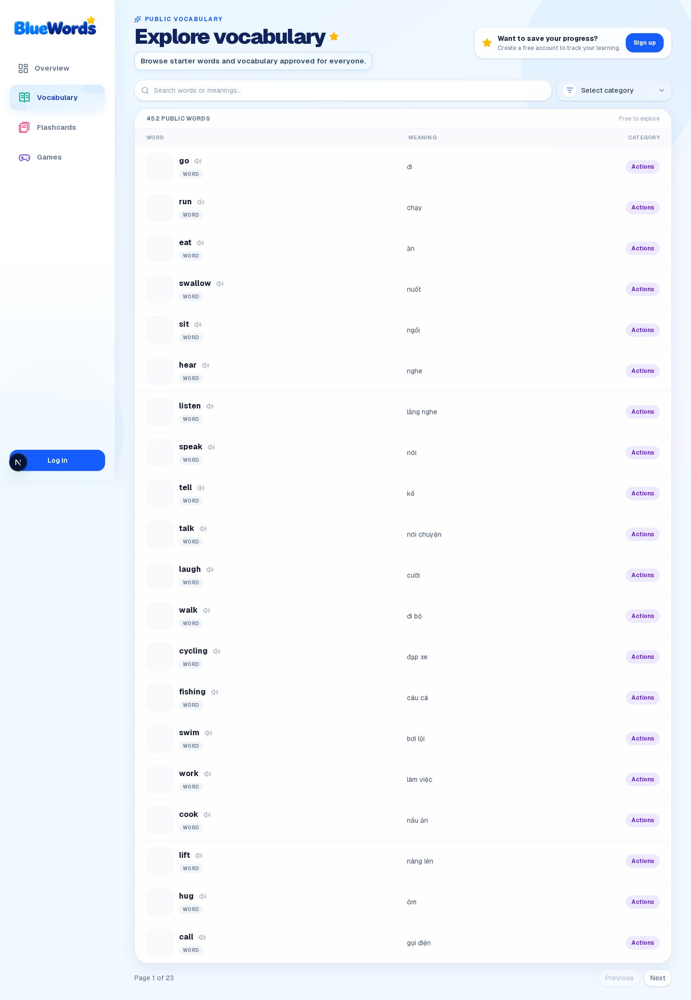
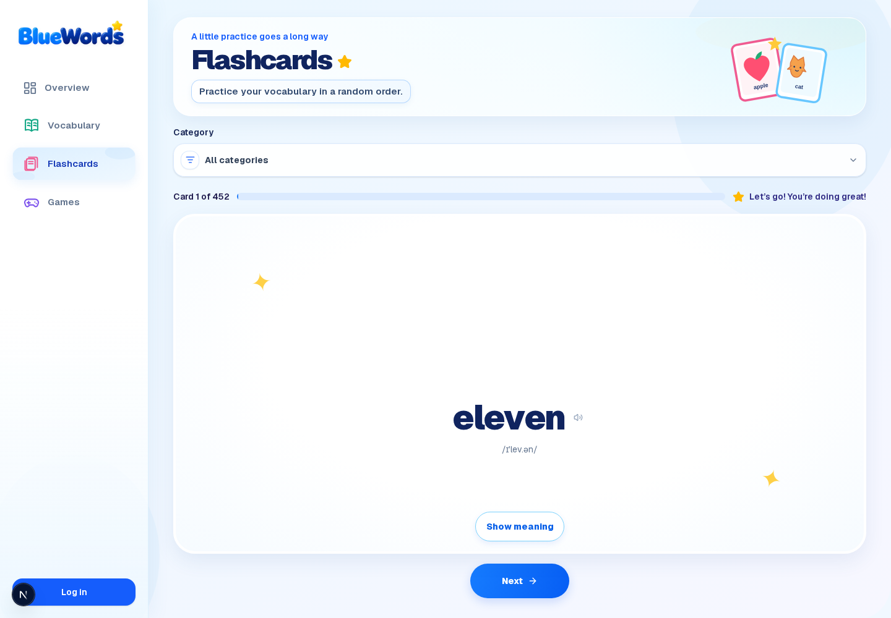
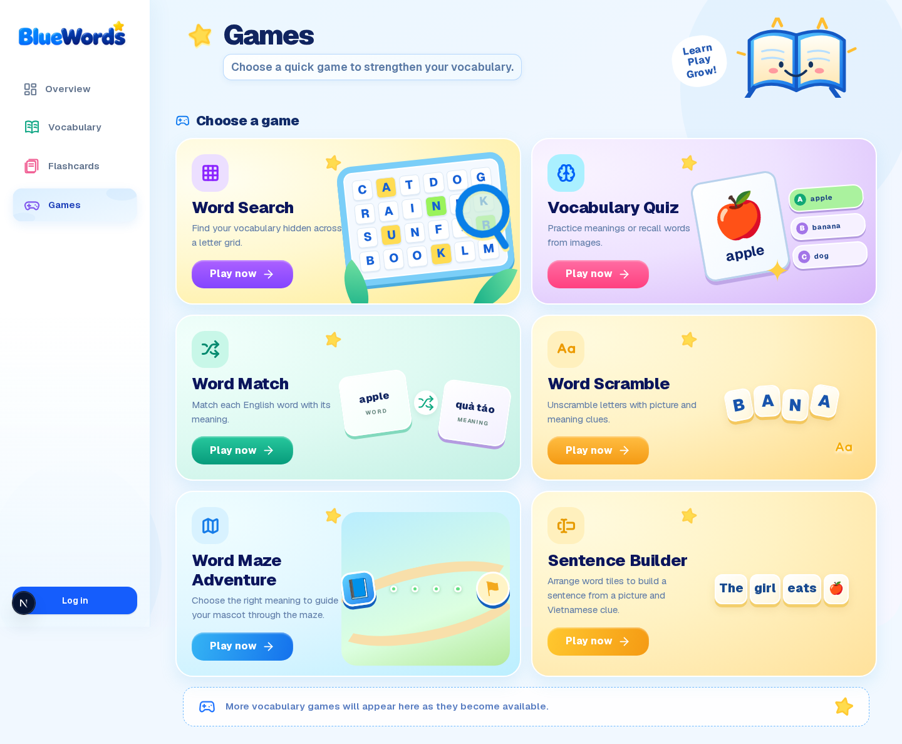
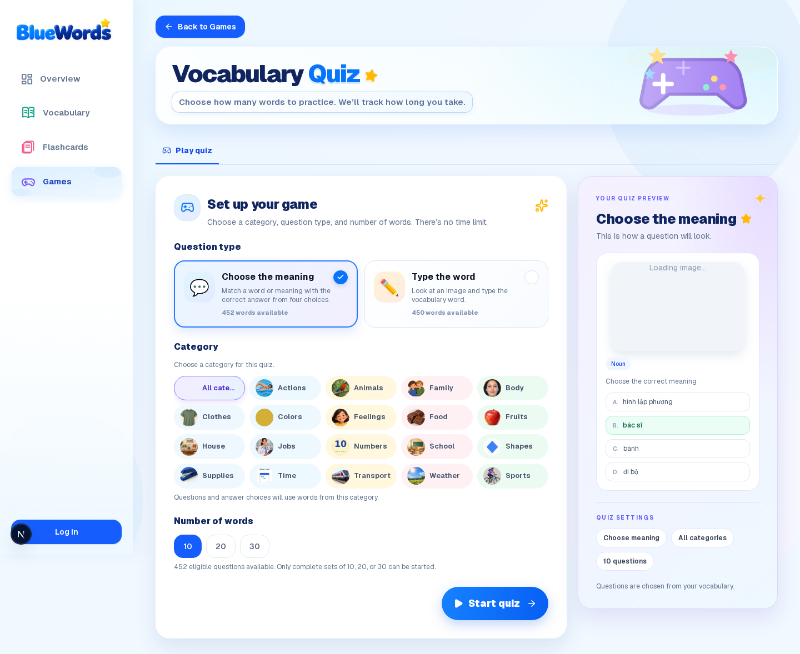
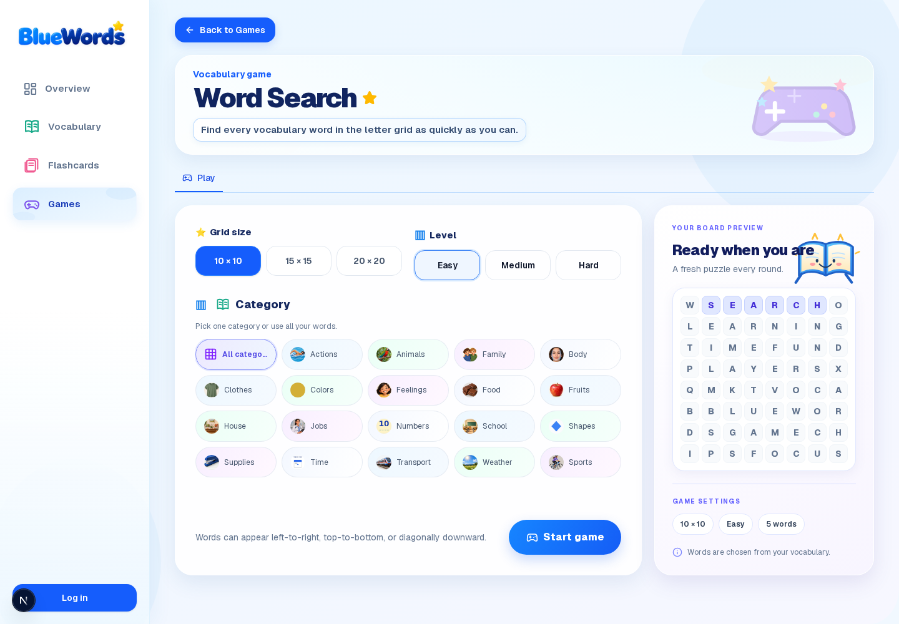

# BlueWords 💙

**Learn words, play, and explore.** BlueWords is a vocabulary learning app for English learners, with a public vocabulary library, personal study tools, vocabulary games, and teacher-assigned assessments.

BlueWords is built with Next.js 16 App Router, TypeScript, Tailwind CSS 4, and Supabase. Authentication, PostgreSQL, and row-level security support private learner data and administrator tools.

### Live app

[bluewords.online](https://bluewords.online)

## Screenshots

These screenshots were captured from the current app on October 27, 2026. The available local browser session was signed out, so these show the public/guest experience. Pages that need an account—personal review history, assignments, and assessment results—are described below but are not represented as signed-in screenshots. Design mockups are listed separately in [the portfolio screenshot guide](docs/portfolio/README.md).

### Overview



### Public vocabulary



### Flashcards



### Games



### Vocabulary quiz



### Word Search setup



## Current features

### Learner experience

- **Sign-in and private vocabulary:** signed-in learners manage their own word list, meanings, images, categories, and Learning/Mastered status. Guests can explore starter and approved community vocabulary.
- **Vocabulary explorer:** search and filter public or personal vocabulary, listen to pronunciation, and browse categories.
- **Flashcards:** review vocabulary, reveal meanings, mark words Learning or Mastered, and filter by category or review status.
- **Daily review:** review Learning and Mastered words by day; the latest review day is selected by default, and learners can choose another day from the calendar.
- **Vocabulary quiz:** choose meaning or type the word, select a category and question count, see a timed result, and review personal quiz history.
- **Word Search:** find vocabulary in a generated letter grid, with grid size, difficulty, and category settings; signed-in players can save results and use the leaderboard.
- **Word Match:** match English words to meanings or pictures; results use points, moves, and elapsed time.
- **Word Scramble:** arrange shuffled letters using picture and meaning clues.
- **Word Maze Adventure:** answer vocabulary questions to guide the mascot along the maze.
- **Sentence Builder:** arrange word tiles into a sentence from a picture and Vietnamese clue. It is available to signed-in learners; scores can be saved to the games leaderboard.
- **Assignments:** signed-in learners see tests assigned to them, start or continue an attempt, and view their own results and history. Other learners' results remain private.
- **Notifications and profile:** see account notifications and manage a public leaderboard nickname/avatar while keeping email private.

### Assessment rules

- Each assigned test contains 10 questions: five vocabulary questions and five sentence-building questions. The order and question selection are randomized for each learner.
- Each correct answer is worth 10 points, for a maximum of 100. A score of 50 or below is a fail and can be retried; a score above 50 completes the assignment.
- The app records correct and incorrect answers, score, duration, and completion time.
- Due dates are optional when an administrator assigns a test; a due date cannot be set in the past.

### Administrator tools

- Manage assessment questions by difficulty (Easy, Medium, Hard), including add/edit/remove and CSV import/export.
- Assign tests to selected learners or all learners, set an optional due date, and notify the recipients.
- Review assignment completion and results from the administrator assessment area.
- Manage user accounts, starter/community categories, publish requests, and in-app notifications.
- Admin-only operations are protected by server authorization and Supabase row-level security.

## Phase scope

- **Phase 1:** vocabulary tracking foundation.
- **Phase 2:** personal learning tools, profiles, categories, flashcards, and review history.
- **Phase 3:** community vocabulary publishing, notifications, and administration.
- **Phase 4:** Word Match, Word Scramble, Word Maze Adventure, Sentence Builder, and game leaderboards.
- **Phase 5:** randomized assessments, assignment delivery, learner attempts/history, and administrator result management.
- **Phase 6 (planned):** situational English lessons organized around real-life communication topics, with vocabulary, useful phrases/collocations, and sentence patterns. This is not part of the current feature set.

## Technology

| Technology | Role |
|---|---|
| Next.js 16 App Router | Web application and server routes |
| React 19 and TypeScript | UI and application logic |
| Tailwind CSS 4 | Styling and responsive layouts |
| Supabase Auth | Sign-in and session handling |
| Supabase PostgreSQL | Application data |
| PostgreSQL row-level security | User and administrator data access rules |
| Supabase SSR | Server-side auth integration |
| Radix UI Dialog | Accessible confirmation dialogs |
| Lucide React and Sonner | Icons and user feedback |
| Vercel | Hosting |

## Run locally

BlueWords uses Node.js 22, selected for this project with `.nvmrc`:

```bash
nvm install
nvm use
npm install
npm run dev
```

Open [http://localhost:3000](http://localhost:3000). If port 3000 is already occupied, Next.js selects another available port.

Create `.env.local` with the Supabase project settings:

```env
NEXT_PUBLIC_SUPABASE_URL=your_supabase_project_url
NEXT_PUBLIC_SUPABASE_PUBLISHABLE_KEY=your_supabase_publishable_key
SUPABASE_SERVICE_ROLE_KEY=your_supabase_service_role_key
DATABASE_URL=your_supabase_session_pooler_connection_string
```

Keep `.env.local` private. `SUPABASE_SERVICE_ROLE_KEY` is server-only and must never use a `NEXT_PUBLIC_` prefix. Apply the repository's Supabase migrations before using database-backed features. The Phase 3 migration runner uses the Supabase Session pooler (`DATABASE_URL`, port 5432); do not use the Transaction pooler for it.

## Project structure

```text
src/
├── app/                 # App Router pages and API routes
├── components/          # Feature UI (games, assessments, vocabulary, admin)
├── config/              # App configuration
├── contexts/            # Shared client state
├── data/                # Vocabulary/domain seed data
├── hooks/               # Reusable React hooks
├── lib/                 # Domain logic, Supabase services, and helpers
└── types/               # Database and application types
data/                    # Starter vocabulary source CSVs and images
docs/portfolio/           # Portfolio screenshots and their provenance
```

## Validation commands

```bash
npm run lint
npx tsc --noEmit
npm run build
```

## Deployment

BlueWords is deployed on [Vercel](https://vercel.com/). Production environment variables and Supabase configuration are managed outside this repository.
