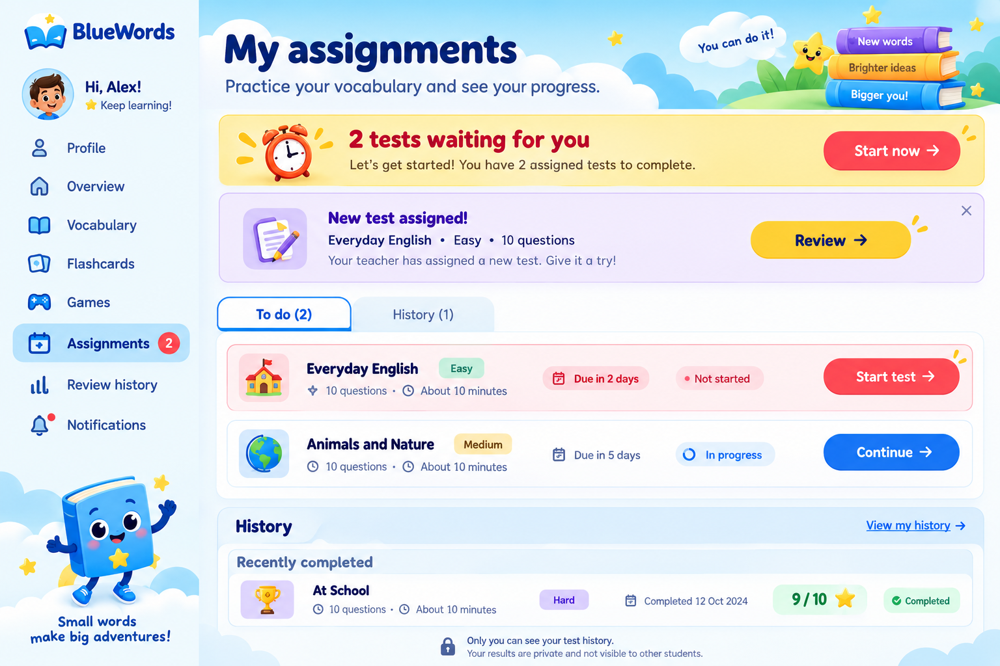
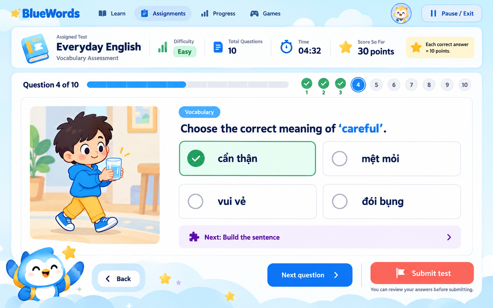
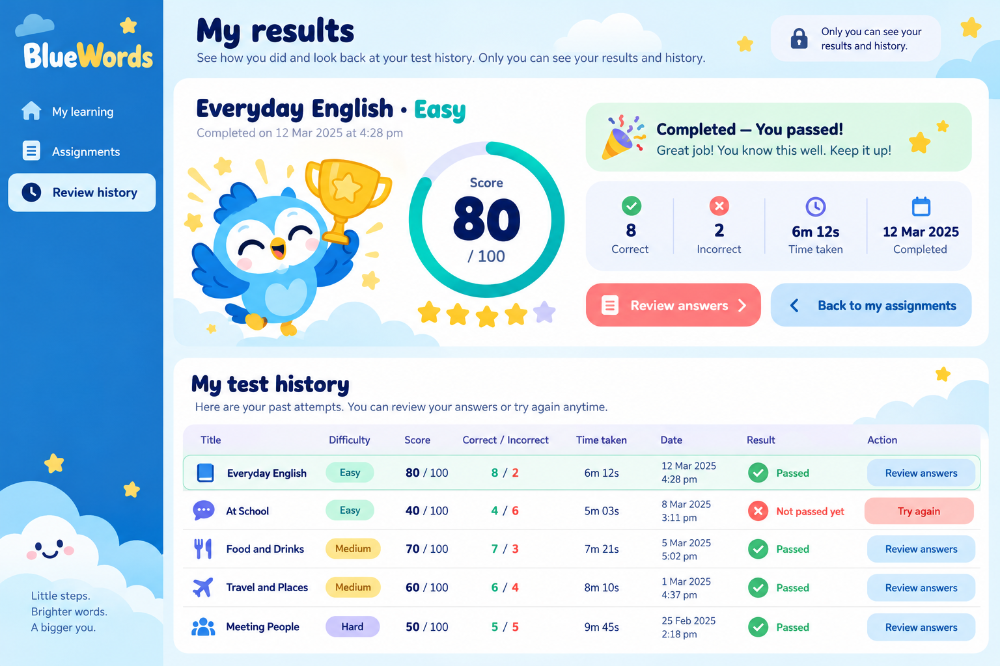
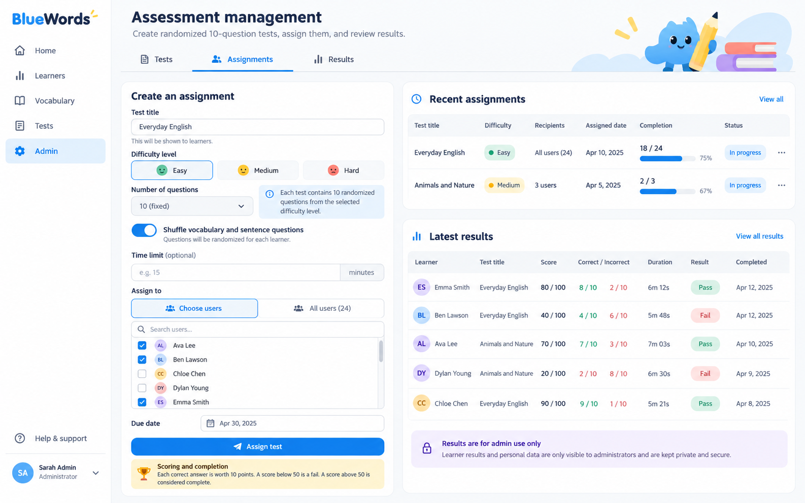
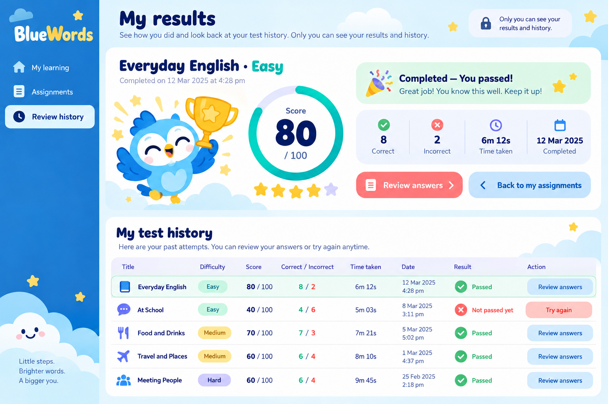

# BlueWords portfolio screenshots

## Current app captures

The `current-*.png` files are real browser captures of the current local application, taken on October 27, 2026. The browser session used for capture was signed out. These images document the public experience and are not screenshots of personal account data.

| Screen | Capture |
|---|---|
| Overview | [current-overview.png](screenshots/current-overview.png) |
| Public vocabulary | [current-vocabulary.png](screenshots/current-vocabulary.png) |
| Flashcards | [current-flashcards.png](screenshots/current-flashcards.png) |
| Games library | [current-games.png](screenshots/current-games.png) |
| Vocabulary quiz setup | [current-quiz.png](screenshots/current-quiz.png) |
| Word Search setup | [current-word-search.png](screenshots/current-word-search.png) |

Assignments, personal review history, and assessment results require an authenticated learner session and were not captured. Capture those screens after signing in with a portfolio/demo account so private learner information is not exposed.

The original [`public/screenshots/dashboard.png`](../../public/screenshots/dashboard.png) and [`public/screenshots/vocabulary.png`](../../public/screenshots/vocabulary.png) are historical product screenshots from an earlier UI version. They are retained for history and should not be presented as current screens.

## Design mockups

The `*-mockup.png` files below are reference designs supplied during product development. They are not browser captures of the current website.

### Phase 2 — Personal learning experience

### Phase 3 — Community and administration

### Phase 4 — Vocabulary games

### Phase 5 — Assessments

These are the user-provided Phase 5 design mockups, saved for portfolio reference. They are not browser captures of the current website.

