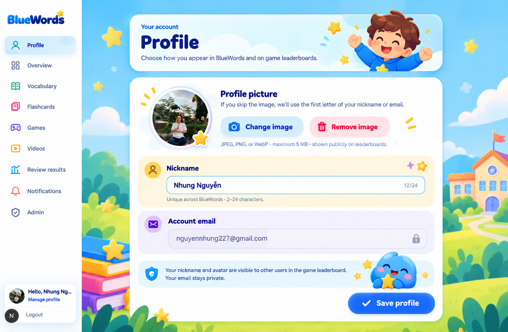
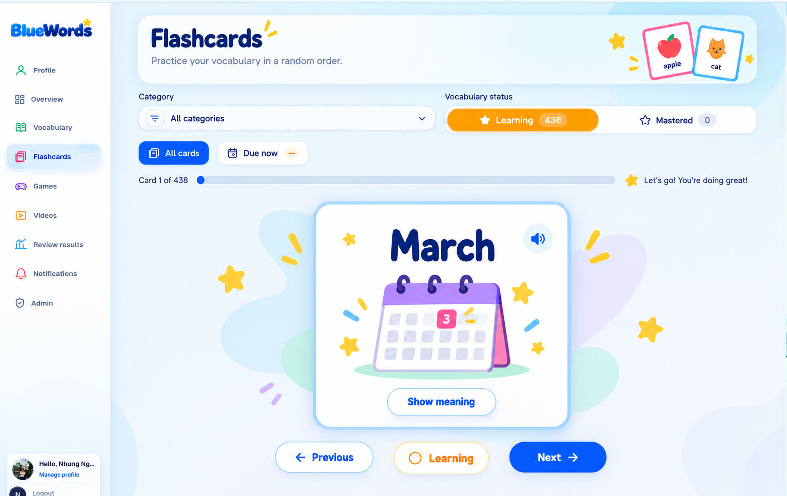
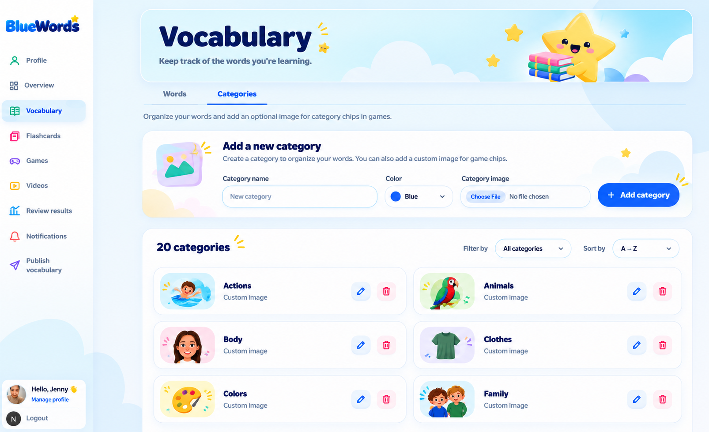
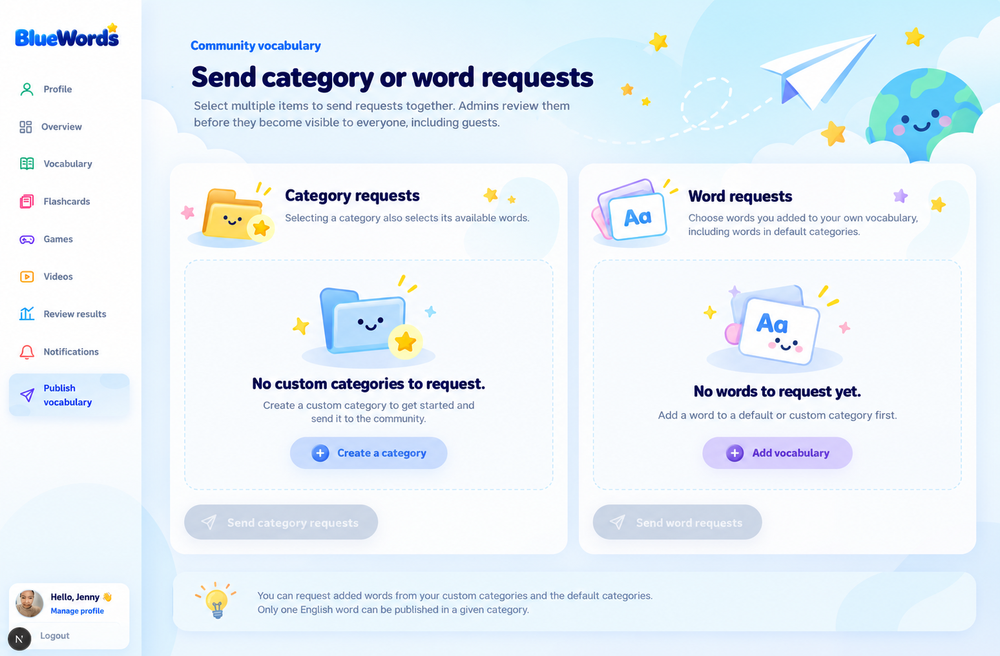
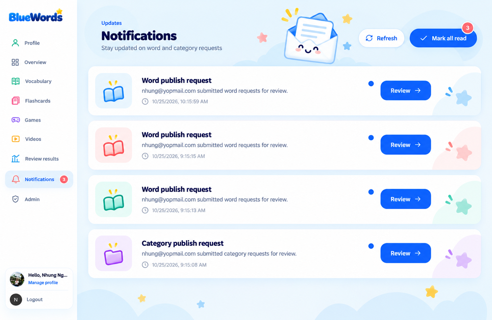
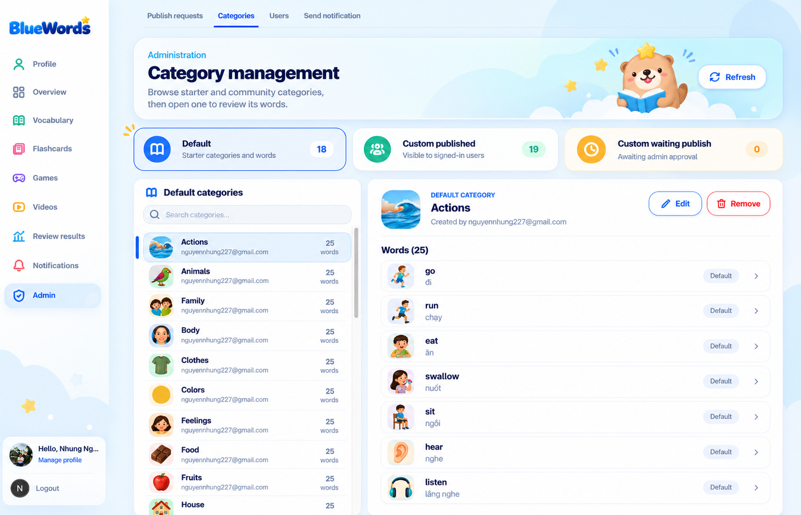
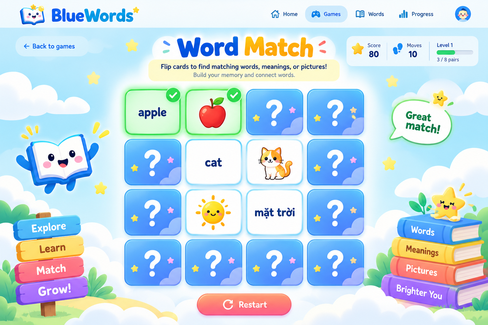
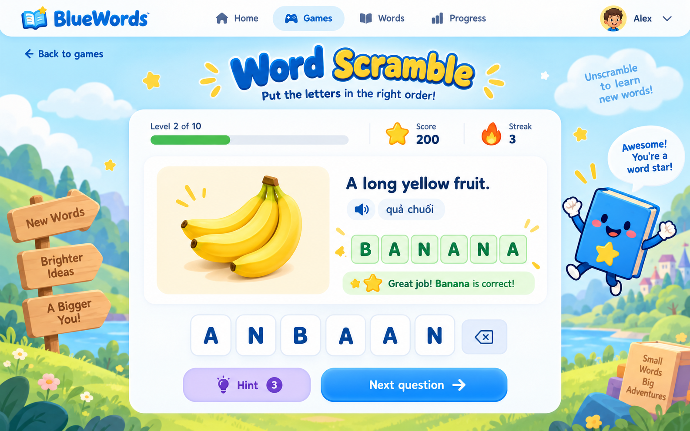
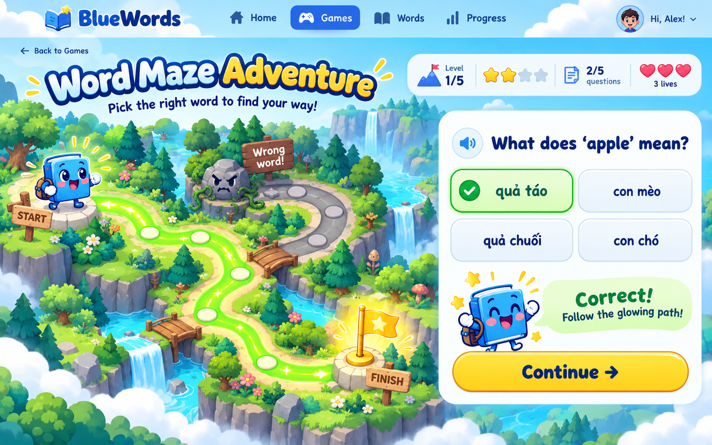
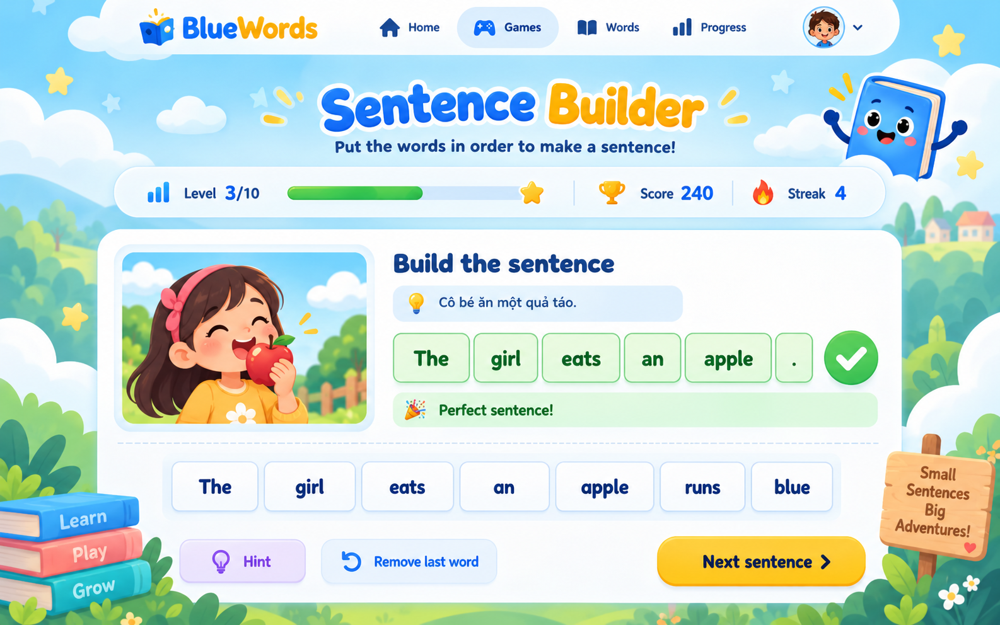

# BlueWords portfolio screenshots

The repository includes the original Phase 1 product screenshots at [`public/screenshots/dashboard.png`](../../public/screenshots/dashboard.png) and [`public/screenshots/vocabulary.png`](../../public/screenshots/vocabulary.png).

The `*-mockup.png` files below are supplied design mockups used to guide the product UI. They are not screenshots captured from the deployed website. Keep that distinction when using them in a portfolio; replace them with live captures when a representative account and environment are available.

## Phase 2 — Personal learning experience

## Phase 3 — Community and administration

## Phase 4 — Vocabulary games

